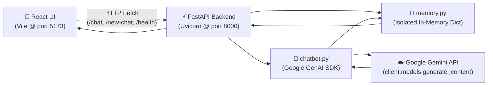

# 🤖 Context-Aware AI Chatbot with Conversation Memory

A beginner-friendly, full-stack AI chatbot built with **FastAPI** (Python backend) and **React** (frontend), powered by the **Google Gemini API** using the official **`google-genai` SDK**.

---

## 📌 Introduction

This project demonstrates how to build a production-style, context-aware AI chatbot from scratch. It connects to the official Google Gemini API using the modern **`google-genai` Python SDK**, maintains per-session conversation memory with automatic context window truncation, and presents a clean, responsive chat UI.

---

## 🚩 Problem Statement

Many chatbot tutorials simulate responses or do not manage conversation state properly. Real-world AI chatbots require:

1. Connecting to a real AI model using standard official SDKs.
2. Remembering prior context across multiple user & assistant turns.
3. Keeping separate conversation histories strictly isolated so users never share memory.
4. Truncating context safely to prevent exceeding token limits, reducing latency and costs.
5. Robust error handling for quota limits, authentication, timeouts, and network issues.

---

## 🚀 Key Features

- **Google Gemini API Integration**: Powered by `gemini-3.5-flash-lite` with automatic fallback to prevent rate-limit disruption.
- **Multi-Turn Conversation Memory**: Retains conversation history per unique `conversation_id`.
- **Context Window Management**: Sliding window truncation (`MAX_HISTORY_MESSAGES=10`) preserves context within token limits.
- **Code Block Syntax Formatting with Copy Button**: Fenced code blocks (` ```python ... ``` `) render with language badges and a one-click "📋 Copy Code" button.
- **Text-to-Speech (TTS)**: Built-in speaker button (🔊) reads AI responses aloud using the browser's native Web Speech API.
- **Interactive Quick Starter Prompts**: Beginner-friendly starter cards to ask about recursion, REST APIs, SQL vs NoSQL, and debugging with a single click.
- **Export Chat History**: "📥 Export" button downloads full transcripts formatted as `.txt` files.
- **Live Character Counter**: Prevents oversized messages with real-time feedback (`0 / 2000`).
- **Session Auto-Recovery**: Reconnects and resumes automatically if the backend restarts.
- **Extended REST Endpoints**: Includes `GET /chat/{id}/stats` and `DELETE /chat/{id}` for session management.

---

## 🛠️ Technology Stack

| Layer | Technology | Description |
|---|---|---|
| **Backend** | Python 3.11+ / FastAPI | High-performance REST API framework |
| **AI SDK** | `google-genai` (v1.12+) | Official Google GenAI Python SDK (`genai.Client`) |
| **Data Validation** | Pydantic v2 | Type validation for incoming requests and outgoing responses |
| **Security** | `python-dotenv` | Secure environment variable handling (never exposes API keys) |
| **Memory** | Python Dictionaries | In-memory conversation store keyed by unique conversation UUIDs |
| **Frontend** | React 18 + Vite | Component-based interactive UI with instantaneous rendering |
| **Styling** | Modern CSS | Dark-themed, responsive layout with loading indicators and avatars |

---

## 🏗️ Architecture



### Data Flow for a Message:
1. User types a prompt and submits it in the React UI.
2. Frontend optimistically displays the user bubble and calls `POST /chat`.
3. `main.py` validates the request body using Pydantic.
4. `memory.py` saves the user's message and returns the latest truncated context window.
5. `chatbot.py` formats the conversation history as `types.Content` and passes it along with `system_instruction` to `client.models.generate_content(...)`.
6. Gemini generates the response, extracted via `response.text`.
7. `memory.py` stores the assistant's reply.
8. The backend returns JSON containing the response text and updated turn count.
9. React renders the assistant's message bubble and smoothly scrolls to the bottom.

---

## 📁 Project Structure

```text
context-aware-ai-chatbot/
│
├── backend/
│   ├── main.py          # FastAPI routes, CORS, error handling
│   ├── chatbot.py       # Google Gemini SDK integration
│   ├── memory.py        # Isolated in-memory store & context truncation
│   ├── prompts.py       # System prompt (Lexi the learning assistant)
│   └── models.py        # Pydantic request/response schemas
│
├── frontend/
│   ├── index.html
│   ├── package.json
│   ├── vite.config.js
│   └── src/
│       ├── main.jsx
│       ├── App.jsx      # Root component, state management & auto-recovery
│       ├── App.css      # Dark-themed modern chat stylesheet
│       ├── components/
│       │   ├── ChatWindow.jsx    # Scrollable chat feed with auto-scroll
│       │   ├── MessageBubble.jsx # Individual user / AI message bubble
│       │   └── ChatInput.jsx     # Textarea & submit button
│       └── services/
│           └── api.js   # Centralized Fetch API service
│
├── tests/
│   └── test_chatbot.py  # Comprehensive test suite (unit, memory, & integration)
│
├── .env.example         # Template for environment configuration
├── .gitignore           # Excludes .env, virtual environments, and node_modules
├── requirements.txt     # Python dependencies
└── README.md            # Project documentation
```

---

## ⚡ Quick Start (Windows PowerShell)

### Prerequisites
- **Python 3.11+** installed
- **Node.js 18+** installed
- **Google Gemini API Key** (free from [Google AI Studio](https://aistudio.google.com/app/apikey))

---

### Step 1: Environment Setup & API Key

1. Navigate to the project directory:
   ```powershell
   cd c:\Users\harin\IdeaProjects\chatbot\context-aware-ai-chatbot
   ```

2. Open your `.env` file:
   ```powershell
   notepad .env
   ```

3. Paste your free Gemini API key:
   ```env
   GEMINI_API_KEY=AIzaSyYourActualKeyHere
   GEMINI_MODEL=gemini-1.5-flash
   MAX_HISTORY_MESSAGES=10
   ```
   Save and close Notepad.

---

### Step 2: Backend Setup & Run

Open a PowerShell terminal:

```powershell
# Navigate to project root
cd c:\Users\harin\IdeaProjects\chatbot\context-aware-ai-chatbot

# Activate virtual environment
.\.venv\Scripts\Activate.ps1

# Install required Python packages
pip install -r requirements.txt

# Start the FastAPI server
cd backend
uvicorn main:app --reload --port 8000
```

The backend server will start at: `http://127.0.0.1:8000`  
Interactive Swagger docs: `http://127.0.0.1:8000/docs`

---

### Step 3: Frontend Setup & Run

Open a **second** PowerShell terminal:

```powershell
cd c:\Users\harin\IdeaProjects\chatbot\context-aware-ai-chatbot\frontend

# Install frontend packages (if not already done)
npm install

# Start Vite dev server
npm run dev
```

The frontend will run at: **`http://localhost:5173`**

Open **http://localhost:5173** in your browser to chat with Lexi!

---

## 🌐 API Endpoints

| Method | Endpoint | Description | Request Body | Response Body |
|---|---|---|---|---|
| `GET` | `/health` | Health check probe | _None_ | `{"status": "ok", "message": "..."}` |
| `POST` | `/new-chat` | Create a new isolated conversation | _None_ | `{"conversation_id": "...", "message": "..."}` |
| `POST` | `/chat` | Send message and receive AI reply | `{"conversation_id": "...", "message": "..."}` | `{"conversation_id": "...", "response": "...", "turn_count": N}` |
| `GET` | `/chat/{id}/stats` | Retrieve conversation statistics | _None_ | `{"conversation_id": "...", "total_messages": N, "user_turns": N, "ai_turns": N, ...}` |
| `DELETE` | `/chat/{id}` | Clear session memory | _None_ | `{"message": "Conversation history cleared successfully", ...}` |

---

## 🧠 Memory & Context Truncation

### In-Memory Storage
All conversations are stored in a dictionary in `memory.py`:
```python
_conversation_store = {
    "uuid-1": [
        {"role": "user", "text": "What is recursion?"},
        {"role": "model", "text": "Recursion is when a function calls itself..."}
    ],
    "uuid-2": [...] # Isolated from uuid-1
}
```

### Sliding Context Window
When a user submits a prompt, `memory.get_context_messages(conversation_id)` retrieves only the last `N` messages:
```python
MAX_CONTEXT_MESSAGES = int(os.getenv("MAX_HISTORY_MESSAGES", "10"))
return history[-MAX_CONTEXT_MESSAGES:]
```
- **System Instruction Isolation**: The system persona prompt is passed separately via `system_instruction` in `GenerateContentConfig`, keeping it out of the per-turn token window.
- **Safety**: Truncation ensures long conversations never exceed token limits or inflate latency.

---

## 🛡️ Error Handling

The application provides beginner-friendly, structured error handling for real-world scenarios:

- **Missing API Key (HTTP 500)**: Alerts you to configure `GEMINI_API_KEY` in `.env`.
- **Invalid API Key (HTTP 401)**: Returns a clear prompt to verify your key from Google AI Studio.
- **Quota Limit Reached (HTTP 429)**: Friendly message explaining that the Gemini free tier allows ~15 requests/minute, suggesting a ~60-second wait before retrying.
- **Server Overloaded / High Demand (HTTP 503)**: Informs the user when Google servers experience spikes in demand.
- **Timeouts / Connection Failure (HTTP 503)**: Highlights internet connectivity issues.
- **Empty Messages (HTTP 400)**: Prevents sending whitespace or empty strings.
- **Unknown Conversation (HTTP 404)**: Frontend automatically recovers by starting a fresh conversation session.

---

## 🧪 Testing

The project includes unit, memory, validation, and integration tests using `pytest`:

```powershell
# From project root with virtual environment activated:
pytest context-aware-ai-chatbot/tests/test_chatbot.py -v
```

### Test Coverage:
1. **Health Check (`TestHealth`)**: Verifies `/health` returns `HTTP 200` with `status: ok`.
2. **New Chat (`TestNewChat`)**: Verifies generation of unique UUIDs and initialization in memory.
3. **Validation (`TestInputValidation`)**: Confirms rejection of empty strings, whitespace, and invalid conversation IDs.
4. **Memory Management (`TestMemory`)**: Tests turn counting, context window truncation, clearing history, and strict session isolation.
5. **Configuration & Key Errors (`TestApiKeyValidation`)**: Tests missing key (HTTP 500) and invalid key handling.
6. **Live Integration (`TestIntegration`)**: Tests live multi-turn conversation memory (5+ turns) when valid credentials are provided.

---

## 🔒 Security Best Practices

- **Zero Hardcoding**: All credentials are read from `.env` via `python-dotenv`.
- **Version Control Exclusion**: `.env`, virtual environment directories (`.venv/`), and `node_modules/` are included in `.gitignore`.
- **Sanitized Logging**: API keys and tokens are never logged or exposed in terminal output.
